<div align="center">



**Autonomous AI agents in production, and the engineers who ship them.**

<a href="https://github.com/kgarbacinski"></a>

<sub>follow, and your avatar lands in <code>/var/log/followers</code> on the next daily run. the cheapest billboard on GitHub.</sub>

</div>

<br/>

### `01` cat about.txt

I build self-directed AI systems and design production platforms as engineer/architect across multiple projects. Founder of **[devs-mentoring](https://devs-mentoring.pl)**: mentorship for developers and AI-engineering consulting for teams moving to agentic workflows. Before that, public-goods infrastructure at [Golem Foundation](https://golem.foundation).

> Prompts = drafts. Loops = products.

### `02` git log --oneline selected-work

`a9e1f37` **[AutoViralAI](https://github.com/kgarbacinski/AutoViralAI)**: researches what's going viral, writes, publishes, measures, then rewrites its own strategy from what worked. One post hit 800 likes. The agent wrote it, not me.<br/>
`7c21d04` **[design-mirror-ai](https://github.com/kgarbacinski/design-mirror-ai)**: extracts any site's design DNA (color, type, spacing, motion) into AI-ready prompts.<br/>
`0b5e88f` **[genetic-snake](https://github.com/kgarbacinski/genetic-snake-with-neural-networks)**: Snake that learns to play through a genetic algorithm and a from-scratch neural net. My first agent. Still proud.

### `03` ls ~/devs-mentoring/services

```
agentic-workflow-audit/     where your team loses hours to work an agent could do
ai-adoption-for-teams/      from "we tried ChatGPT" to agents in the delivery pipeline
senior-1on1-mentoring/      for devs who want to be the one building the agents
```

**→ [devs-mentoring.pl](https://devs-mentoring.pl)**

### `04` mail kacper

> **Dear Kacper,**<br/>
> I'd like to talk about \_\_\_\_\_\_\_\_\_\_.<br/>
> — yours, \_\_\_\_\_\_\_\_\_\_

kacpergarbacinski@gmail.com<br/>
the full story, with a papercraft diorama: **[caspercooks.tech](https://caspercooks.tech)**

<br/>

<sub>half of this README is code. the code half rewrites itself every morning: <a href="scripts/quest.py"><code>scripts/quest.py</code></a></sub>
